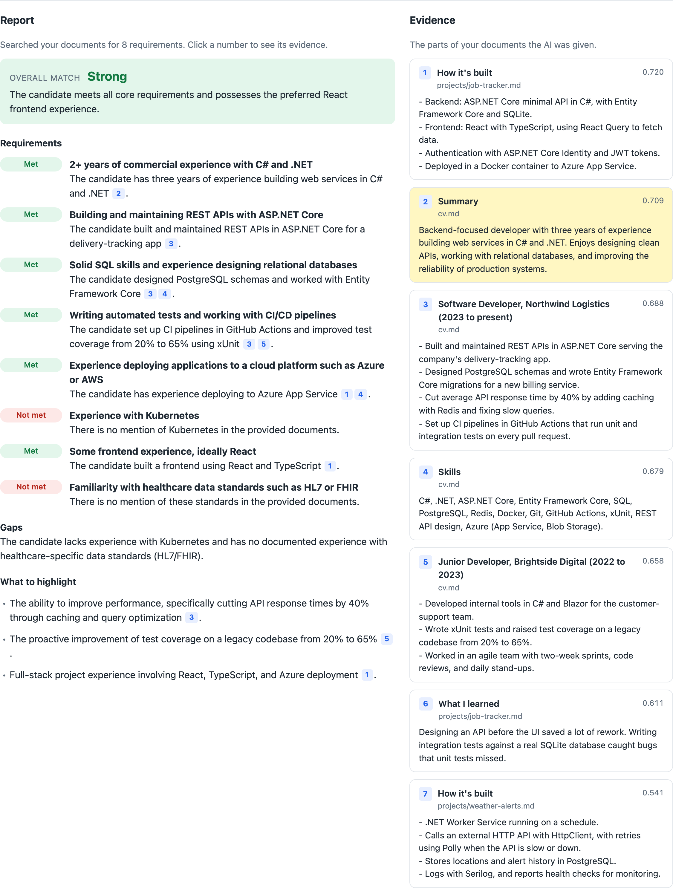
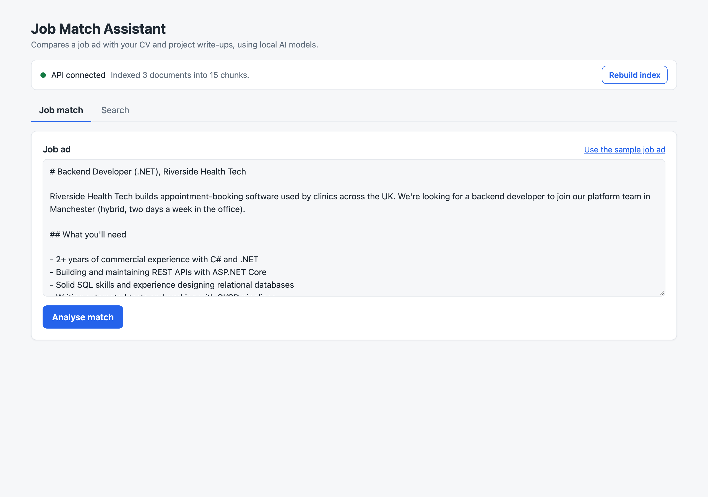
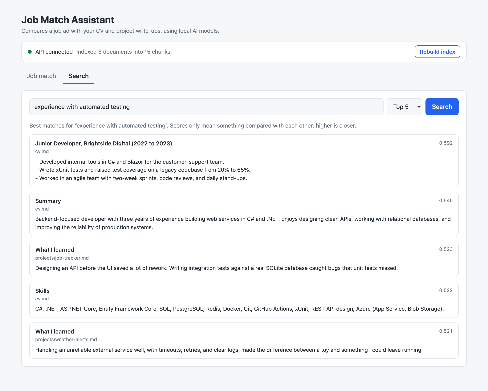
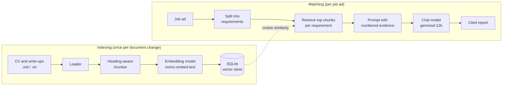

# Generalised RAG Engine

**A retrieval-augmented generation (RAG) engine in C#/.NET that runs entirely on local AI models.** Its first application is a job-match assistant: paste a job ad, and it checks each requirement against a CV and project write-ups, then writes a report in which every claim cites its evidence.

It runs on local models through [Ollama](https://ollama.com), so no data leaves your machine. The public demo runs the same engine on Google's hosted Gemini models instead, which is a settings change rather than a code change.



## What it does

- **Matches a job ad against your documents.** It splits the ad into requirements, finds the strongest evidence for each in your CV and project write-ups, and asks a local LLM for a structured verdict.
- **Shows its sources.** Every claim in the report cites numbered evidence, so you can check it. Clicking a citation highlights the passage it came from.
- **Says what's missing.** The model is told to use only the evidence it's given, so a requirement with no supporting evidence is reported as "Not met" rather than glossed over.
- **Measures its own search quality.** An evaluation set of questions with known answers scores retrieval with recall@k and MRR, so changes are judged by numbers rather than by eye.

<details>
<summary>More screenshots</summary>

**Entering a job ad**



**Searching the documents directly**



</details>

## How it works



| Step | Code | What it does |
|---|---|---|
| Load | [`DocumentParser`](src/Rag.Documents/DocumentParser.cs), [`TextFileLoader`](src/Rag.Core/Loading/TextFileLoader.cs) | Reads uploaded PDF, Word, Markdown and text files. Headings in Word files, and likely headings in PDFs (detected from font size, bold and capitals), become Markdown headings so the chunker can follow the CV's sections. |
| Chunk | [`MarkdownSectionChunker`](src/Rag.Core/Chunking/MarkdownSectionChunker.cs) | Splits documents along their headings into chunks of up to about 800 characters. Each chunk starts with its heading path, e.g. "Experience > Software Developer". |
| Embed and store | [`DocumentIndexer`](src/Rag.Core/Indexing/DocumentIndexer.cs), [`SqliteVectorStore`](src/Rag.Sqlite/SqliteVectorStore.cs) | Embeds chunks in batches and stores text, metadata and vectors. Re-indexing a document replaces its old chunks. |
| Retrieve | [`VectorRetriever`](src/Rag.Core/Retrieval/VectorRetriever.cs), [`VectorMath`](src/Rag.Core/Similarity/VectorMath.cs) | Embeds the question and ranks chunks by cosine similarity. |
| Generate | [`JobMatchAnalyzer`](src/Rag.Core/JobMatching/JobMatchAnalyzer.cs), [`JobMatchPrompt`](src/Rag.Core/JobMatching/JobMatchPrompt.cs) | Retrieves evidence per requirement, merges and de-duplicates it, and prompts the model for a fixed-format report. |
| Evaluate | [`RetrievalEvaluator`](src/Rag.Core/Evaluation/RetrievalEvaluator.cs), [`evals/`](evals/) | Scores retrieval against expected text snippets. |

Every class opens with a plain-English explanation of what it does and the main choices behind it.

## Design decisions

- **Provider-independent AI.** The engine only depends on the [Microsoft.Extensions.AI](https://learn.microsoft.com/dotnet/ai/microsoft-extensions-ai) interfaces (`IChatClient`, `IEmbeddingGenerator`). `Rag:Provider` picks Ollama (local) or Gemini (hosted, through its OpenAI-compatible endpoint), and nothing else changes.
- **Visitors' data is private and short-lived.** Each upload gets its own in-memory collection under a random session ID. It's never written to disk, and it's deleted when the visitor clicks Remove or after 60 minutes.
- **Safe to leave online.** Upload size and count limits, per-visitor rate limits, a cap on sessions in memory, and a site-wide daily allowance of AI calls protect the free tiers it runs on. A job ad's requirements are embedded in one batched request, so a report costs about three AI calls instead of ten.
- **Chunks follow the document's structure.** A CV is already divided into meaningful sections, so chunks follow its headings instead of fixed character counts, and each chunk repeats its heading path so it makes sense on its own. That makes overlap between chunks unnecessary.
- **One search per requirement.** Embedding a whole job ad blends many skills into one vague vector. Searching for each requirement separately finds specific evidence.
- **Every requirement gets some evidence.** When merging results, each requirement's best chunk is included first, and the remaining slots are filled by score. Otherwise the requirements that are easiest to match could take every slot.
- **Grounded, cited output.** The system prompt limits the model to the numbered evidence and asks it to cite it. A low temperature (0.2) keeps reports consistent between runs.
- **Evals that survive re-chunking.** Expected answers are text snippets ("GitHub Actions") rather than chunk IDs, so the same eval set still works after chunking changes. A unit test checks that every snippet exists in the sample documents.
- **Problems are caught early.** Vector stores reject embeddings of the wrong size or from a different model with a clear message. The API returns standard problem-details errors with messages written for visitors: 400 for an unreadable file, 404 for an expired session, 429 at a limit, 503 when the AI is busy.

## Results

**Retrieval quality** on the 10-question eval set (top 3 results per question). The run compares nomic-embed-text's optional `search_query:` / `search_document:` prefixes against no prefixes:

| Setting | Recall@3 | MRR | Hit rate@3 |
|---|---|---|---|
| With prefixes (default) | 0.85 | 0.67 | 0.90 |
| Without prefixes | 0.80 | 0.73 | 0.80 |

With prefixes, more of the expected evidence was found. Without them, the first relevant result ranked higher on average. With only 10 questions the difference is small, which is why the eval set exists: the next retrieval change can be measured the same way. The eval also exposed a weak spot: a question about improving performance misses a CV bullet about cutting response times, because that bullet sits inside a large chunk about a whole job.

**Speed:** a full match report takes about 15–30 seconds on an Apple M5 Max, most of it spent generating the report.

## Tech stack

| Area | Technology |
|---|---|
| Engine and API | C# / .NET 10, ASP.NET Core minimal APIs, Microsoft.Extensions.AI |
| Models | Locally: Ollama with `gemma4:12b` (chat) and `nomic-embed-text` (embeddings). Hosted: Google Gemini. |
| Documents | PdfPig (PDF text and layout), Open XML SDK (Word) |
| Storage | In memory for visitor sessions, SQLite (Microsoft.Data.Sqlite) for the command-line tool. Brute-force cosine search, with pgvector planned for scale. |
| Front end | React 19, TypeScript, Vite |
| Testing | xUnit (117 tests, including in-memory API tests with `WebApplicationFactory` and a fake clock), Vitest (8 tests) |
| Hosting | API in Docker on Render, web page on Netlify |

## Running it

**You need:** the [.NET 10 SDK](https://dotnet.microsoft.com/download), [Node.js](https://nodejs.org) and [Ollama](https://ollama.com). On a Mac with Homebrew: `brew install dotnet node ollama`.

```bash
# 1. Start Ollama and download the models (about 8 GB)
brew services start ollama
ollama pull gemma4:12b
ollama pull nomic-embed-text

# 2. Start the app: this runs the API and the web page together
cd web
npm install
npm run dev
```

Open **http://localhost:5173**, upload your CV (or click **Try the sample CV**, a fictional candidate from [`samples/`](samples/)), then **Use a sample job ad** and **Analyse match**.

<details>
<summary>Other ways to run it</summary>

**Command line** (from `src/`):

```bash
dotnet run --project Rag.Playground -- index
dotnet run --project Rag.Playground -- search "cloud experience"
dotnet run --project Rag.Playground -- match
dotnet run --project Rag.Playground -- eval
```

**API only** (`dotnet run --project src/Rag.Api`, on http://localhost:5209):

| Endpoint | What it does |
|---|---|
| `GET /health` | Returns `Healthy` if the API is running. |
| `GET /api/info` | The AI provider in use and the upload limits. |
| `POST /api/sessions` | Upload 1–3 files (multipart form, field `files`). Returns a private `sessionId`. |
| `POST /api/sessions/sample` | Use the sample CV instead. |
| `GET` / `DELETE /api/sessions/{id}` | Check a session, or delete it and its documents now. |
| `GET /api/search?q=...&topK=5&sessionId=...` | The best-matching chunks for a question (`topK` 1–20). |
| `POST /api/match` with `{ "jobAd": "...", "sessionId": "..." }` | Requirements, evidence and the match report. |

[`Rag.Api.http`](src/Rag.Api/Rag.Api.http) has ready-made requests, and the OpenAPI description is at `/openapi/v1.json` in Development.

**Tests:** `dotnet test` from the repository root, and `npm test` in `web/`. Neither needs Ollama, because the tests use fake models.

</details>

## Deployment

The public demo is the same code with different settings:

- **API on [Render](https://render.com)**, built from the [`Dockerfile`](Dockerfile) using [`render.yaml`](render.yaml). The service sets `Rag__Provider=Gemini`, and the Gemini API key is entered as a secret in Render's dashboard (`Rag__Gemini__ApiKey`). It's never committed.
- **Web page on [Netlify](https://www.netlify.com)**, built from `web/` using [`netlify.toml`](netlify.toml). `VITE_API_URL` points the page at the API, and the API allows the page's address through `Rag__AllowedOrigins__0`.

To try Gemini locally, store the key in .NET's user secrets (outside the repository), then start the API with the Gemini provider:

```bash
dotnet user-secrets set "Rag:Gemini:ApiKey" "<your key>" --project src/Rag.Api
Rag__Provider=Gemini dotnet run --project src/Rag.Api
```

## Project structure

```
src/
  Rag.Core/          The engine: loading, chunking, indexing, retrieval, job matching, evaluation
  Rag.Documents/     Reading uploaded PDF and Word files
  Rag.Sqlite/        SQLite vector store
  Rag.Api/           ASP.NET Core minimal API: sessions, search, matching, limits
  Rag.Playground/    Command-line tool (index, search, match, eval)
web/                 React front end
tests/               xUnit tests for the engine, documents, SQLite store and API, plus shared fakes
evals/               Retrieval eval set
samples/             Fictional CV, project write-ups and job ad
docs/                Case study and screenshots
Dockerfile, render.yaml, netlify.toml   Hosting configuration
```

## Roadmap

- [x] **Week 1:** Ollama and first chat and embedding calls
- [x] **Weeks 2–3:** Loading, chunking, retrieval with SQLite
- [x] **Week 4:** API and job-ad analysis
- [x] **Weeks 5–6:** Evals, tests, React front end, write-up

## Limitations and next steps

- **Search scans every chunk.** That's fine for a CV's worth of text but not for large collections. The next step is pgvector, which searches using an index inside the database.
- **Scanned PDFs aren't supported.** They contain images rather than text, and reading them would need OCR.
- **Retrieval improvements to measure with the eval set:** smaller chunks for dense sections, hybrid keyword and vector search, and re-ranking.
- **The hosted demo runs on free tiers**, so the first visit after a quiet spell waits about a minute while the server wakes, and there's a daily usage cap.

For the full story, including the experiments and what they changed, see the [case study](docs/case-study.md).
